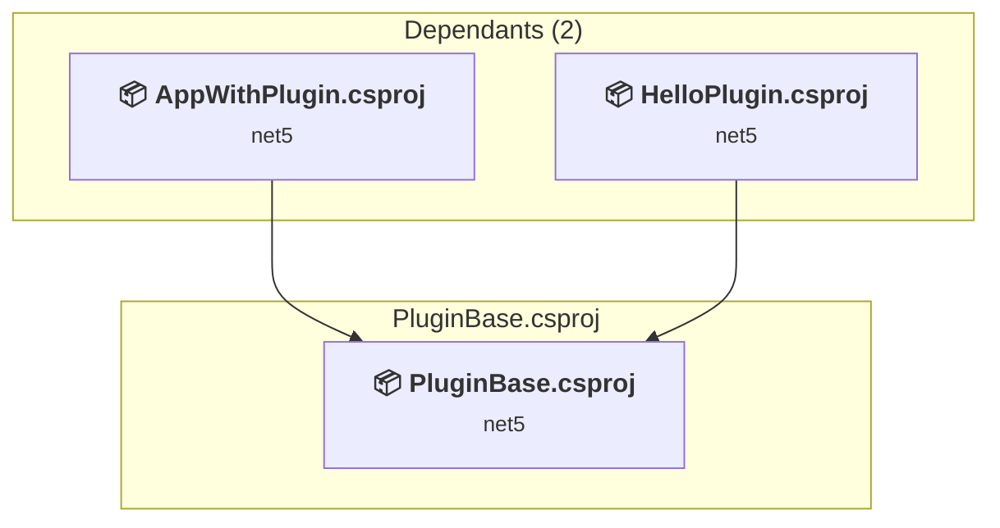

# PluginBase\PluginBase.csproj

[← Back to the assessment index](../../assessment.md)

## Project Info

- **Current Target Framework:** net5
- **Proposed Target Framework:** net11.0
- **SDK-style**: True
- **Project Kind:** ClassLibrary
- **Dependencies**: 0
- **Dependants**: 2
- **Number of Files**: 1
- **Number of Files with Incidents**: 1
- **Lines of Code**: 10
- **Estimated LOC to modify**: 0+ (at least 0.0% of the project)

## Related Projects

**Depended on by (2)** — projects that reference this one:

- [C:\Users\wiwagn\GitHub\fork\docs\samples\snippets\core\tutorials\creating-app-with-plugin-support\csharp\AppWithPlugin\AppWithPlugin.csproj](../projects/AppWithPlugin.md)
- [C:\Users\wiwagn\GitHub\fork\docs\samples\snippets\core\tutorials\creating-app-with-plugin-support\csharp\HelloPlugin\HelloPlugin.csproj](../projects/HelloPlugin.md)

## Dependency Graph

Legend:
📦 SDK-style project
⚙️ Classic project

## API Compatibility

| Category | Count | Impact |
| :--- | :---: | :--- |
| 🔴 Binary Incompatible | 0 | High - Require code changes |
| 🟡 Source Incompatible | 0 | Medium - Needs re-compilation and potential conflicting API error fixing |
| 🔵 Behavioral change | 0 | Low - Behavioral changes that may require testing at runtime |
| ✅ Compatible | 5 |  |
| ***Total APIs Analyzed*** | ***5*** |  |

